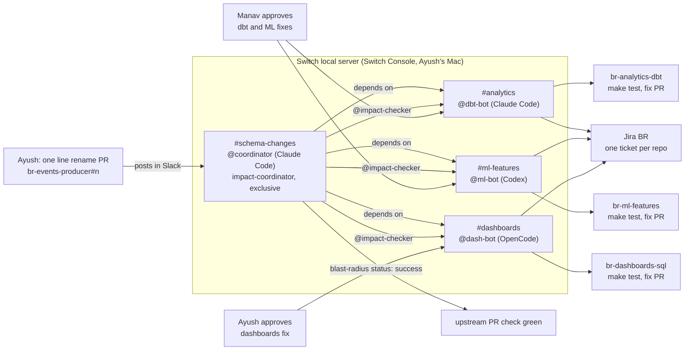

# Blast Radius

### Know what your schema change breaks before you merge it.

**One upstream schema change, four Switch agents on three providers: each one tests the change in the repo it speaks for, files a Jira ticket, opens a fix PR, and the upstream check turns green only after every repo owner approves in Slack.**

TODO: demo video link (YouTube, unlisted, under 3 minutes) goes here.

TODO: GIF of the fan out in #schema-changes goes here.

Built for the Flip the Switch hackathon (Track 1 and Track 2) by Ayush Gawai and Manav Patel.

## How we use Switch

Every step of the workflow runs on a Switch feature. Without Switch there is no room, no fan out, no owner check.

| Workflow piece | Switch feature | Shown on screen as |
| --- | --- | --- |
| Team channels #schema-changes, #analytics, #ml-features, #dashboards | **Rooms**, created by the template as Slack channels | The Slack channel list |
| #schema-changes knows which team rooms depend on it | **Room links** labelled "depends on", in one group `blast-radius` | Coordinator names the linked rooms in its reply |
| Agents from Claude Code, Codex and OpenCode in one room | **Multiple providers** through Switch Console | Agent names and avatars in the thread |
| One coordinator per change | **Exclusive role** `impact-coordinator` | `!roles` output |
| One mention reaches every downstream agent | **Shared role** `impact-checker` | `@impact-checker` fans out to 3 agents |
| Each agent knows its repo | **GitHub references** with instructions, plus a clone of the repo as the agent's working dir | Agent quotes the exact file and failing check |
| A ticket for every breakage | **Atlassian connection** (Jira project `BR`) and a Jira reference | Jira keys in the thread and in fix PR titles |
| Team working rules | **Room instructions** | Short, threaded, plain replies |
| Durable impact report | **Room scoped document** `impact-<pr-number>` | Coordinator links the document |
| Only the owner can approve a fix | **Who can instruct an agent** (`addressing` in agent settings) | A refusal on camera, then the real owner approves |
| Readable handles | **Aliases** | `@coordinator`, `@dbt-bot`, `@ml-bot`, `@dash-bot` |
| Reproducible setup | **Agent template YAML**, run from Console or by switch-buddy | [`switch/blast-radius.template.yaml`](switch/blast-radius.template.yaml) |



## Agents we connected

All four agents run on Ayush's Mac through Switch Console. Each agent's working directory is a clone of the repo it speaks for (`~/.switch/agents/<server>/br-*`).

| Agent | Alias | Provider | Role | Rooms | Repo it speaks for | Who can instruct it |
| --- | --- | --- | --- | --- | --- | --- |
| `br-coordinator` | `@coordinator` | Claude Code | `impact-coordinator` (exclusive) | schema-changes | `br-events-producer` (owner Ayush) | Ayush and his other agents (`owner-agents`) |
| `br-dbt` | `@dbt-bot` | Claude Code | `impact-checker` (shared) | schema-changes, analytics | `br-analytics-dbt` (owner Manav) | Ayush, and anyone in schema-changes or analytics (`anyone_in`) |
| `br-ml` | `@ml-bot` | Codex | `impact-checker` (shared) | schema-changes, ml-features | `br-ml-features` (owner Manav) | Ayush, and anyone in schema-changes or ml-features (`anyone_in`) |
| `br-dash` | `@dash-bot` | OpenCode | `impact-checker` (shared) | schema-changes, dashboards | `br-dashboards-sql` (owner Ayush) | Ayush and his other agents (`owner-agents`) |

`@dash-bot` leaves Manav out on purpose: it is the agent we use to show Switch refusing someone who is not the owner. For `@dbt-bot` and `@ml-bot`, Switch lets both humans talk to the agent, and the team room instructions say only the repo owner named in the README can approve.

## How the channels are set up

Everything below is in one file, [`switch/blast-radius.template.yaml`](switch/blast-radius.template.yaml). It is generated from the Markdown sources, so edit those and rebuild:

```
switch/rooms/schema-changes.md   switch/rooms/analytics.md
switch/rooms/ml-features.md      switch/rooms/dashboards.md
switch/roles/impact-coordinator.md   switch/roles/impact-checker.md

python3 scripts/build_template.py    # rewrites switch/blast-radius.template.yaml
```

- **Rooms:** `schema-changes`, `analytics`, `ml-features`, `dashboards`, each a Slack channel, all in the group `blast-radius`. Both humans are members of all four.
- **Room links:** `schema-changes` to each team room, label `depends on`.
- **Room instructions:** #schema-changes: the coordinator restates the change and addresses `@impact-checker`; each checker replies in the thread with repo, failing command, trimmed error lines, Jira ticket and a one line fix plan, or "no impact" with the command it ran. Team rooms: the agent posts its fix PR and Jira ticket, waits for the repo owner, never merges, and after approval comments "approved by <owner> in Switch" on the PR and the ticket, moves the ticket to Done and reports back.
- **Role instructions:** `impact-coordinator` reads the upstream PR with `gh`, creates the Jira parent issue, sets the `blast-radius` commit status, writes the `impact-<n>` room document and clears the PR when every owner has approved. `impact-checker` runs `UPSTREAM_REF=<branch> make test`, files a Jira issue, opens a fix PR on `fix/<n>` and posts it in its team room.
- **References:** a GitHub reference per repo (upstream on #schema-changes, one per team room) and a Jira reference for project `BR`.
- **Aliases:** set by the template: `@coordinator`, `@dbt-bot`, `@ml-bot`, `@dash-bot`. To set one by hand: `!set-alias @br-dbt @dbt-bot`. Check with `!list-aliases` and `!roles`.
- **Kickoff:** the template posts one message in #schema-changes so each agent takes its role and says which repo it speaks for.

**Load the template:** Switch Console, **Templates**, **Import template**, pick `switch/blast-radius.template.yaml`, fill in `gh_user` (owner of the demo repos) and `teammate` (your teammate's Slack user), then run it. Or ask switch-buddy in chat: "Run the template in blast-radius/switch/blast-radius.template.yaml".

## Run it yourself

**Prerequisites**

- [Switch Console](https://github.com/sandbox-quantum/switch/releases/latest), with the local server running ("On this computer")
- Docker Desktop (the local server needs it)
- Claude Code, Codex and OpenCode, each signed in in Console
- A Slack workspace connected to the Switch server, and an Atlassian (Jira) site connected under Settings, Connections, with a project key `BR`
- `gh` logged in (`gh auth login`), `git`, `make`, Python 3.12 and [uv](https://docs.astral.sh/uv/)

**1. Publish the four demo repos to your GitHub account**

```
make seed GH_USER=<you> TEAMMATE=<teammate github handle>
```

This creates `br-events-producer`, `br-analytics-dbt`, `br-ml-features` and `br-dashboards-sql`, gives your teammate push access to the dbt and ML repos, and makes `main` of `br-events-producer` require the `blast-radius` check. It is safe to rerun.

The role instructions name `ayushgawai/br-events-producer` and the Jira site `ayushsunilgawai.atlassian.net`. If you use your own, edit `switch/roles/*.md` and run `python3 scripts/build_template.py`.

**2. Create the Switch setup:** run the template (see above). Then make sure each agent has its repo cloned:

```
make agent-dirs
```

**3. Check in Slack**, in #schema-changes: `!roles` should show `br-coordinator` holding `impact-coordinator` and the three checkers holding `impact-checker`.

**4. Open the upstream PR and get the demo message**

```
make break          # opens "Rename user_id to account_id in events" on branch rename-user-key
make demo-message   # prints the message to post
```

Post the printed message in #schema-changes:

> Heads up team: I'm renaming user_id to account_id in the events table. PR: <PR URL>. @coordinator what does this break?

**5. Reset between runs**

```
make reset-demo     # closes demo PRs, deletes fix/* and demo branches, resets the agent dirs
```

**Without GitHub or Switch**

```
make verify       # local end to end check
make demo-local   # same, and prints each failing run's output
```

`make verify` builds the upstream data locally and checks that every repo is green on `main`, that exactly the 6 breakages appear on the rename, that every repo is green after the fixes, and that `add-device-type` breaks nothing. It exits 0 only when all of that holds.

## What happens in a run

These are the real numbers from rehearsal 1 on upstream PR [#2](https://github.com/ayushgawai/br-events-producer/pull/2).

1. **The human change.** Ayush edits `producer/schema.py` in `br-events-producer`: `USER_KEY = "user_id"` becomes `USER_KEY = "account_id"`, on branch `rename-user-key`, PR "Rename user_id to account_id in events". Backup: `make break`.
2. **The announcement.** Ayush posts the `make demo-message` text in #schema-changes.
3. **The coordinator.** `@coordinator` restates the change in one line, names the rooms that depend on #schema-changes (#analytics, #ml-features, #dashboards), addresses `@impact-checker` with the branch to test, creates the Jira parent issue and sets the `blast-radius` status on the PR to pending.
4. **The checkers.** Each runs `UPSTREAM_REF=rename-user-key make test` in its own repo and reports in the thread:
   - `@dbt-bot`: `br-analytics-dbt`, models `fct_sessions` and `dim_users` fail, Binder Error: column `user_id` not found.
   - `@ml-bot`: `br-ml-features`, `test_user_aggregates` and `test_feature_matrix_shape` fail, KeyError: `user_id`.
   - `@dash-bot`: `br-dashboards-sql`, queries `daily_active_users` and `revenue_by_user` fail, Binder Error: column `user_id` not found; `sessions_per_day`, `top_pages`, `event_mix` pass.

   Each files a Jira ticket (rehearsal 1: BR-4, BR-5, BR-6), opens a fix PR on `fix/2` and posts it in its team room: [br-analytics-dbt#1](https://github.com/ayushgawai/br-analytics-dbt/pull/1), [br-ml-features#1](https://github.com/ayushgawai/br-ml-features/pull/1), [br-dashboards-sql#1](https://github.com/ayushgawai/br-dashboards-sql/pull/1). CI is green on all three.
5. **The impact report.** `@coordinator` posts "Impact report for PR #2: 6 breakages in 3 repos, 3 fix PRs open", links the `impact-2` room document and waits on Ayush and Manav.
6. **The refusal.** Manav types in #dashboards: "@dash-bot looks good, approved." Switch does not pass the message to `@dash-bot`, because Manav is not allowed to instruct it.
7. **The real approvals.** Ayush in #dashboards: "@dash-bot approved, thanks." Manav in #analytics: "@dbt-bot approved." Manav in #ml-features: "@ml-bot approved." Each bot comments "approved by <owner> in Switch" on its PR and Jira ticket, moves the ticket to Done and reports back to #schema-changes.
8. **The close.** `@coordinator` sets the `blast-radius` status to success, "6 breakages fixed across 3 repos", moves the Jira parent to Done and posts "PR #2 cleared: 6 breakages fixed across 3 repos. All owners approved." The upstream PR's required check is green.

## No impact case

The agents should not cry wolf. `make break-device` opens "Add nullable device_type column to events" on branch `add-device-type`, and `make demo-message-device` prints:

> Adding a nullable device_type column to events. PR: <PR URL>. @coordinator what does this break?

Every checker should reply "no impact" with the command it ran, and the coordinator sets the status to success with "No downstream impact". `make verify` checks this case locally: all repos are green on `add-device-type`.

## Built by voice

We built this by voice with [Wispr Flow](https://wisprflow.ai/?promo_code=WEMAKEDEVS): the prompts to the coding agents that built this repo, the room and role instructions in `switch/`, the messages to switch-buddy, and the Slack messages, including the announcement in the demo, which Ayush dictates on camera.

TODO: confirm this list against what we actually dictated, and add both Wispr usage cards.

## Limitations and what we would build next

What Switch did differently than we expected, and what we did about it:

- **No GitHub connector on a local server.** Switch Console's local server sets `GATEWAY_PUBLIC_URL=http://localhost:...`, and the GitHub connector needs https. Agents use the local `gh` login instead; the GitHub references in Switch are pointers that tell agents to use `gh` and `git`.
- **Template `repo:` clone did not happen for 2 of 4 agents.** We cloned by hand; `make agent-dirs` now clones or resets every agent's working dir.
- **Template references need a wrapper.** In template v2 a list item with a `value` key is read as an `{if, value}` conditional, and every reference has `value`. We wrap a room's references in one `- value: [...]` entry.
- **Bundled Mattermost needs Docker's default socket.** It needs Docker with "Allow the default Docker socket" turned on. We used Slack instead: it works from a laptop over Socket Mode, and Manav joins from his own laptop.
- **Slack app manifest.** Copy it from the Switch docs as JSON.
- **Refusal message.** Until Manav links his Slack account to a Switch user, the refusal on `@dash-bot` reads as "not linked" rather than "not permitted". The refusal still happens.
- **Per person permissions.** Template `addressing` has `owner`, `owner-agents`, `anyone` and `anyone_in`. There is no "these two people" option, so for `@dbt-bot` and `@ml-bot` the "only the owner approves" rule lives in the room instructions, and Switch enforces it hard only on `@dash-bot`.

Not about Switch: Jira projects get the key `KAN` by default, so we renamed ours to `BR`. The dbt bot fixed the rename with one alias in `stg_events` (`account_id as user_id`) instead of the 3 file rename in SPEC.md; both are valid fixes, and `make verify` checks the SPEC version.

Next: per person addressing in the template, a GitHub connector on the local server, and a real CI step that posts the announcement automatically when a PR touches a shared schema.

## Team

- Ayush Gawai, GitHub [@ayushgawai](https://github.com/ayushgawai): owns `br-events-producer` and `br-dashboards-sql`
- Manav Patel, GitHub [@Patel-manav20](https://github.com/Patel-manav20): owns `br-analytics-dbt` and `br-ml-features`

License: [MIT](LICENSE).
